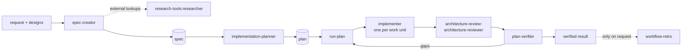

# sdd-engineering

Spec Driven Development for Claude Code. It turns a feature request into a spec, a plan, working code and a verification report, with independent review gates in between.

## Install

```bash
claude plugin marketplace add olena-shabetia/olena-shabetia-dev-digest-ai-marketplace
claude plugin install sdd-engineering@dev-digest-ai-marketplace
```

Installing this plugin also installs three dependencies at `^1.0.0`:

| Dependency | Why |
|---|---|
| `engineering-paved-path` | Shared engineering skills the agents load |
| `research-tools` | The read-only `researcher` that `spec-creator` delegates to |
| `architecture-review` | The `architecture-reviewer` used in the review gate |

Requires Claude Code `>=2.1.110`. See [COMPATIBILITY.md](COMPATIBILITY.md).

## How the pieces work together



1. **`spec-creator`** (agent) turns a request, plus exported design images, into an EARS spec. Open questions stay visible as `[NEEDS CLARIFICATION]` markers.
2. **`implementation-planner`** (agent) reads the finished spec and writes a plan of work units with exclusive file ownership and frozen contracts. It first asks whether to plan for parallel (`multi-agent`) or sequential (`single-agent`) execution.
3. **`run-plan`** (skill) executes the plan wave by wave with one `implementer` per unit, then runs `architecture-reviewer` and `plan-verifier`, with at most two fix rounds.
4. **`workflow-retro`** (skill) reviews how the agents worked together. It runs only when you ask.
5. **`engineering-insights`** (skill) records non-obvious findings in a decision log, with your approval.

Each step is a separate, deliberate command. `run-plan` never writes a spec or a plan, and the planner never writes a spec.

## Quick start

```text
1. @agent-sdd-engineering:spec-creator  Add a "saved searches" feature. Design: designs/saved-searches.png
2. (answer any [NEEDS CLARIFICATION] markers, then run spec-creator again to resolve them)
3. @agent-sdd-engineering:implementation-planner  Plan specs/saved-searches.md
4. /sdd-engineering:run-plan plans/saved-searches.md specs/saved-searches.md
5. /sdd-engineering:workflow-retro        (optional)
```

## Inputs and outputs

| Step | Reads | Writes | Default location |
|---|---|---|---|
| `spec-creator` | request, designs, instruction files, decision logs, existing specs, validation code | one spec file | `specs/<slug>.md` |
| `implementation-planner` | the spec, instruction files, code | one plan file | `plans/<slug>.md` |
| `run-plan` | the plan, optionally the spec | code (through `implementer`) | the units' owned paths |
| `plan-verifier` | plan or spec, the diff | nothing (report only) | |
| `workflow-retro` | the current conversation | ledger entry | `docs/retro/` |
| `engineering-insights` | the touched module | an approved entry | nearest `INSIGHTS.md` |

If your repository documents other locations or naming, the agents follow those. They never assume a folder layout: they read `CLAUDE.md` / `AGENTS.md`, decision logs and `docs/` first.

## Agents

| Agent | Model | May write | Notes |
|---|---|---|---|
| `sdd-engineering:spec-creator` | opus | spec directory only | May call `research-tools:researcher`, nothing else |
| `sdd-engineering:implementation-planner` | opus | plan directory only | Never writes a spec or code |
| `sdd-engineering:implementer` | sonnet | its work unit's owned paths | Never commits, installs or edits shared registries |
| `sdd-engineering:plan-verifier` | sonnet | nothing | Verdicts: `MET`, `PARTIAL`, `UNMET`, `CANNOT VERIFY` |

## Skills

| Skill | Command | Purpose |
|---|---|---|
| `run-plan` | `/sdd-engineering:run-plan <plan> [<spec>]` | Execute an approved plan with review and verification |
| `workflow-retro` | `/sdd-engineering:workflow-retro [--deep]` | Retrospective on a multi-agent run; manual only |
| `engineering-insights` | `/sdd-engineering:engineering-insights` | Propose and append findings to `INSIGHTS.md` |

## When no test command is found

The `implementer` uses the commands in its work unit, then the package's own scripts and your instruction files. It never invents a command. If it finds none for a tier, it reports that tier as `not found` under `GATES`, says where it looked, and ends the unit as `partial` unless the plan states the unit has no testable behavior. To avoid this, state your lint, test and typecheck commands in `AGENTS.md`.

## Safety model

- Agents that review (`plan-verifier`, `architecture-reviewer`) cannot write files.
- Writers are confined by instruction to one directory each (specs, plans, owned paths), because agent frontmatter cannot scope `Write` by path.
- Implementers cannot run `git add/commit/push`, install dependencies, edit lockfiles, or re-baseline a gate.
- No hooks, MCP servers or credentials ship with this plugin.

## Known limitations

- Agents preload many skills through `skills:`, which is the main driver of per-run cost. This is the intended target of the cost experiment in `docs/COST-BASELINE.md`.
- Preloading a skill from a dependency plugin by namespaced name (`skills: - engineering-paved-path:zod`) is not explicitly documented. It was verified to work on Claude Code 2.1.299 for `architecture-reviewer`; re-check after upgrading.
- Behavior evals are not part of the 1.0.0 candidate yet.

## Versioning

SemVer, tags `sdd-engineering--v<version>`. Dependencies are released first. See [CHANGELOG.md](CHANGELOG.md).
